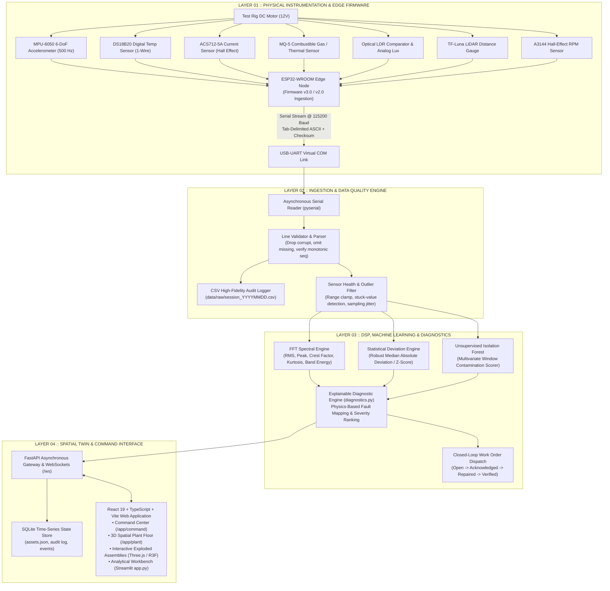
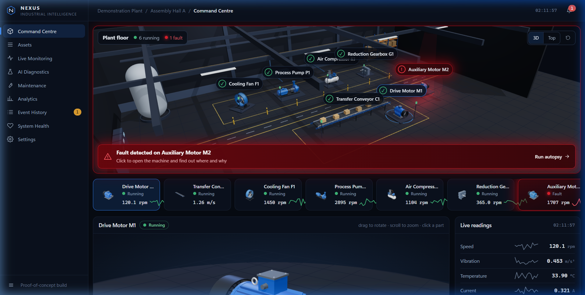

<div align="center">



<br/>


<br/><br/>

[](#)
[](#)
[](#)
[](#)
[](#)
[](#)
[](#)

</div>

---

## 1. Executive Summary

**NEXUS** is an industrial-grade digital twin and predictive condition monitoring platform engineered for rotating machinery and electromechanical drive units. Built around an instrumented **ESP32 edge node** measuring multi-axial vibration, thermodynamic dissipation, and power consumption, the platform bridges physical machinery with an interactive **3D spatial plant model**. 

Unlike conventional "black-box" monitoring dashboards, NEXUS emphasizes **signal integrity, transparent physical diagnostics, and deterministic maintenance workflows**. Telemetry is ingested without destructive zero-imputation, processed via 500 Hz windowed Fast Fourier Transform (FFT) analysis, scored using unsupervised Isolation Forest models combined with robust statistical baseline spreads, and automatically translated into component-level root-cause autopsies with closed-loop work order tracking.

```
┌────────────────────────────────────────────────────────────────────────────────────────┐
│                                 ENGINEERING AUDIT TRAIL                                │
│  • Edge Telemetry: 115200 Baud Deterministic Tab-Delimited Stream w/ Sequence Check    │
│  • High-Frequency Dynamic Domain: 500 Hz Tri-Axial Acceleration Bursts (MPU-6050)      │
│  • Diagnostic Engine: Deterministic Signal Bounds + Unsupervised Multivariate Anomaly  │
│  • Spatial Visualization: React 19 + Three.js 3D Plant Model with Exploded Assemblies  │
│  • Verification Status: 155 Automated Unit & Ingestion Tests Passing                   │
└────────────────────────────────────────────────────────────────────────────────────────┘
```

---

## 2. System Architecture

The system is partitioned into four decoupled layers: **Physical Edge Acquisition**, **Ingestion & Stream Validation**, **Deterministic Analytics & ML Scoring**, and the **Spatial Digital Twin & Command Interface**.



---

## 3. Hardware Instrumentation & Pin Configuration

The physical rig incorporates industrial-equivalent sensing modalities mounted directly to the bearing housing, stator chassis, and shaft coupling of a geared DC machine.

<div align="center">

| Component | Sensor IC / Module | Bus / Interface | Nominal Pin (ESP32) | Measurement Range | Engineering Function |
| :--- | :--- | :--- | :--- | :--- | :--- |
| **Tri-Axial IMU** | MPU-6050 | I²C (0x68) | SDA: `GPIO 21`<br/>SCL: `GPIO 22` | ±2g / 500 Hz burst | Captures high-frequency acceleration bursts (256 samples) for RMS, crest factor, and FFT spectral peak calculation. |
| **Thermodynamic Monitor** | DS18B20 | 1-Wire Digital | Data: `GPIO 4` | −55 °C to +125 °C | Monitors bearing jacket and stator thermal rise. Disconnected sensor yields explicit omission (never zero). |
| **Current Sensor** | ACS712-5A | Analog ADC | `GPIO 34` (ADC1) | 0.0 A to 5.0 A (185 mV/A) | Measures motor load fluctuations, locked-rotor spikes, and phase resistance anomalies. Averaged across 20 ADC reads. |
| **Gas / Ambient Air** | MQ-5 | Analog ADC | `GPIO 36` (ADC1) | Indicative Counts | Detects thermal breakdown of insulation varnish, bearing grease combustion, or electrical arcing. |
| **Optical Tachometer** | LDR Comparator | Digital Input | `GPIO 39` (Sensor VN) | 0 / 1 Logic | Verifies shaft optical interruptions and reflective optical gate timing. |
| **Time-of-Flight LiDAR** | TF-Luna | UART Serial | RX: `GPIO 16`<br/>TX: `GPIO 17` | 20 cm to 800 cm | Precision clearance and shaft axial displacement monitoring (1 cm resolution). |
| **Rotational Encoder** | A3144 Hall-Effect | Digital Interrupt | `GPIO 27` | 0 to 10,000 RPM | Magnetic pulse-per-revolution shaft speed tracking for 3D twin kinematic synchronization. |
| **Acoustic Indicator** | Active Piezo Buzzer | Digital GPIO | `GPIO 25` | 85 dB @ 10 cm | Hardware annunciator with hardware-enforced 2-second timeout protection. |

</div>

> [!NOTE]
> **Electrical Safety Notice:** The ACS712 and MQ-5 output analog signals referenced to 5V VCC. When interfacing with ESP32 ADC1 inputs (3.3V maximum tolerance), an external resistive divider or 3.3V clamping circuit must be verified before connecting signal lines to GPIO 34 / GPIO 36.

---

## 4. Operational Capabilities & Engineering Features

### 4.1. Spatial 3D Factory Twin & Exploded Assembly Inspection
- **Interactive Factory Floor:** Renders a complete plant cell containing an instrumented primary drive motor (`MOTOR-001`), transfer conveyor (`CONV-101`), industrial cooling fan (`FAN-201`), centrifugal process pump (`PUMP-301`), reciprocating air compressor (`COMP-401`), and multi-stage reduction gearbox (`GEAR-501`).
- **Exploded Component Kinematics:** Allows operators to disassemble virtual machines in real time down to bearings, stator windings, impellers, rotor shafts, and gear teeth to inspect thermal hot-spots and mechanical stress points.
- **Color-Coded Stress Mapping:** Machines dynamically transition from healthy industrial slate (`#484C52`) to warning amber (`#FF9900`) and critical industrial orange (`#FF5400`) based on live telemetry thresholds.

### 4.2. Explainable AI & Deterministic Diagnostics
- **No Black-Box Hallucinations:** Unlike generative approaches, diagnostic assessments stem from physical failure modes codified in `backend/diagnostics.py`.
- **Root-Cause Analysis Autopsy:** When vibration rises concurrently with thermodynamic escalation, the engine isolates mechanical bearing inner/outer race wear versus acoustic unbalance or electrical stator failure.
- **Confidence Ranking:** Identifies the primary fault mechanism, calculates evidentiary confidence, lists alternative explanations, and outputs actionable physical maintenance recommendations.

### 4.3. Digital Twin Command Center Interface
Below is an actual captured view of the production 3D Digital Twin Command Center, displaying real-time kinematic machinery state, machine cards, live sensor trends, and alarm feeds:

<div align="center">
  
  <p><em>Figure 1: NEXUS Command Center — 3D plant floor rendering, telemetry metrics (RPM, RMS vibration, temperature, current), and real-time fault autopsy overlay.</em></p>
</div>

---

## 5. Working Principle & Signal Pipeline

The telemetry lifecycle guarantees that noise, sensor brownouts, or dropped packets never poison diagnostic records:

```
[ PHYSICAL MOTOR ]
       │
       ▼ (Sensors: MPU6050, DS18B20, ACS712, MQ-5, Hall)
[ FIRMWARE v3.0 ACQUISITION ]
       │ ── 500 Hz Bursts (256 counts/burst)
       │ ── 1 Hz Slow Telemetry: Vibration, Temp, Gas, Current, Seq
       ▼
[ SERIAL STREAM PROTOCOL ]
       │ ── "Vibration:0.12\tTemperature_C:30.25\tCurrent_A:0.148\tSeq:123"
       │ ── (Missing sensors omitted; never replaced with zero)
       ▼
[ DETERMINISTIC PARSER & MASKING ]
       │ ── Sequence continuity checks (detects USB buffer drops)
       │ ── Physical sanity clamps (DS18B20 85°C / -127°C error flags dropped)
       │ ── Delta checks: flags stuck sensor readings & ADC saturation
       ▼
[ FEATURE EXTRACTION PIPELINE ]
       ├── Spectral Domain: FFT Peak Frequency (Hz), RMS Acceleration, Crest Factor
       ├── Statistical Domain: Rolling Mean, StdDev, Kurtosis, Skewness
       └── Baseline Comparison: Robust Z-Score = (x - median) / (1.4826 * MAD)
       ▼
[ ANOMALY DETECTION ENGINE ]
       ├── Static Engineering Thresholds (Warning / Critical Limits)
       ├── Unsupervised Isolation Forest (Trained on healthy baseline runs)
       └── Cumulative Drift Monitor (Detects progressive degradation)
       ▼
[ EXPLAINABLE ROOT-CAUSE DIAGNOSIS ]
       ├── Matches signature against ISO 10816-3 vibration bands
       ├── Pinpoints exact defective component (e.g. Drive Bearing DE)
       └── Dispatches closed-loop maintenance work order with severity tag
```

---

## 6. Real-Time Telemetry Protocol Specification

### 6.1. Node to Host (Telemetry & Burst Packets)
Data packets are transmitted in ASCII format over 115200 baud UART, separated by tab characters (`\t`):

```text
Vibration:0.12	Temperature_C:30.25	Gas_ADC:612	Current_A:0.148	LDR_DO:1	RPM:1480	Seq:123
A	7	1000200	4096	-2048	12
STATUS	device=ESP32-NODE-01	fw=3.0.0	buzzer=1	rpm=1
ACK	CMD-12	OK	buzzer on
```

- **Missing Fields:** If a sensor fails or disconnects, its key is omitted from the line. It is **never** coerced to `0`, preventing false freeze or cold readings.
- **Burst Lines (`A`):** Transmit burst index, microsecond timestamp (`t_us`), and tri-axial acceleration (`ax`, `ay`, `az`) where $4096 \text{ counts} = 1.0\text{g}$.

### 6.2. Host to Node (Command Protocol)
The host issues safe, strictly validated maintenance and test commands to the edge node:

```text
CMD	<seq>	<command_id>	<NAME>	<argument>
```

| Command Name | Argument Range | Functional Description | Firmware Safety Guard |
| :--- | :--- | :--- | :--- |
| `PING` | None | Echo test verifying link latency. | Monotonic sequence check. |
| `REQUEST_STATUS` | None | Queries firmware revision, active pinouts, and peripheral health. | Replies with formatted `STATUS` string. |
| `BUZZER_ALERT` | `50` to `2000` (ms) | Sounds physical piezo annunciator for test or emergency. | Hardware timer auto-shuts off at 2000 ms. Rejects repeat alerts within 3 seconds. |

---

## 7. Technology Stack

<div align="center">

| Subsystem | Core Technologies | Specification / Version |
| :--- | :--- | :--- |
| **Physical Edge** | C++ / Arduino Core, OneWire, DallasTemperature | ESP32-WROOM-32, UART @ 115200 Baud |
| **Backend Core** | Python, FastAPI, Uvicorn, WebSockets, PySerial | Python 3.13+, AsyncIO Event Loop |
| **Signal Processing & ML** | NumPy, Pandas, Scikit-Learn, SciPy | 500 Hz FFT, Isolation Forest, Robust MAD |
| **Spatial 3D Twin** | React 19, TypeScript, Three.js, React Three Fiber, Drei | WebGL 2.0, Framer Motion, Lucide Icons |
| **Analytical Workbench** | Streamlit, Altair, Matplotlib | Multi-session comparative audit suite |
| **Persistence** | SQLite3, CSV High-Resolution Audio/Vibration Logs | WAL Mode, ACID-compliant local storage |
| **Testing & Quality** | Pytest, Benchmarks, Flake8 | 155 automated unit & integration tests |

</div>

---

## 8. Repository Layout

```
Motor Condition Monitoring/
├── docs/
│   └── assets/
│       ├── hero-banner.svg               # Swiss Engineering dynamic vector header
│       ├── typing-status.svg             # Terminal status animation
│       └── command_center_3d_twin.png    # High-resolution 3D Twin Command Center capture
│
├── nexus/                                # NEXUS Enterprise 3D Twin Application
│   ├── backend/
│   │   ├── main.py                       # FastAPI gateway, REST routes & WebSocket stream
│   │   ├── engine.py                     # Digital twin fleet state & work order state machine
│   │   ├── diagnostics.py                # Explainable root-cause diagnosis rules
│   │   ├── simulation.py                 # Multi-machine physical simulation engine
│   │   ├── device.py                     # Serial port link, packet parsing & command guard
│   │   ├── security.py                   # Role-based access control (Admin/Operator/Viewer)
│   │   ├── store.py                      # SQLite persistent event and audit store
│   │   ├── assets.json                   # Industrial plant configuration & assembly definitions
│   │   ├── requirements.txt              # Backend dependencies
│   │   └── tests/                        # 27 backend test cases
│   ├── frontend/
│   │   ├── src/
│   │   │   ├── pages/                    # Command, Plant, Operations, Reliability, Analysis
│   │   │   ├── three/                    # 3D Factory scenes, assemblies, kinematics, motion
│   │   │   ├── components/               # Industrial UI components, line charts, navigation
│   │   │   └── lib/store.ts              # Zustand live state mirror & WebSocket client
│   │   ├── package.json                  # React 19, Three.js, R3F dependencies
│   │   └── vite.config.ts                # Production build pipeline
│   ├── firmware/
│   │   └── nexus_motor_node/             # ESP32 firmware v3.0 (two-way command protocol)
│   ├── .env.example                      # Environment configuration template
│   └── run_nexus.bat                     # Single-click launcher
│
├── predictive_maintenance/               # Dedicated Offline Analytical Workbench
│   ├── app.py                            # Streamlit multi-page diagnostic suite
│   ├── config.py                         # Telemetry thresholds, baud rates, sensor schema
│   ├── requirements.txt                  # Analytics & ML dependencies
│   ├── HARDWARE_CHECKLIST.md             # Electrical safety & physical calibration guide
│   ├── firmware/
│   │   └── motor_monitor_v2/             # ESP32 firmware v2.0 (high-rate burst capture)
│   ├── src/
│   │   ├── detection/                    # Isolation Forest, drift monitor, robust baseline
│   │   ├── ingestion/                    # Serial reader, CSV logger, synthetic generator
│   │   ├── monitoring/                   # Alert engine, sensor status, session manager
│   │   ├── processing/                   # FFT spectrum, vibration metrics, quality validation
│   │   └── reporting/                    # HTML report generator & maintenance log exports
│   └── tests/                            # 128 automated diagnostic unit tests
│
├── .gitignore                            # Production credentials, cache & binary ignore
└── README.md                             # Comprehensive technical documentation
```

---

## 9. Installation & Deployment Guide

### 9.1. Prerequisites
- **Python 3.11 - 3.13** installed and present on your `PATH`.
- **Node.js 20+ & npm** (optional, only required if modifying the 3D frontend sources; compiled production bundle is pre-built in `frontend/dist`).
- **Arduino IDE / ESP-IDF** (optional, required only for flashing physical ESP32 boards).

### 9.2. Quick Launch: 3D Digital Twin Platform (NEXUS)

```bash
# 1. Navigate to the backend directory
cd nexus/backend

# 2. Install Python dependencies
python -m pip install -r requirements.txt

# 3. Launch the FastAPI server (serves the pre-compiled 3D twin web app)
python -m uvicorn main:app --port 8000
```

Open **`http://localhost:8000`** in your browser.  
*(Alternatively, on Windows, simply double-click `nexus/run_nexus.bat`)*.

On first launch, NEXUS automatically initializes an operational environment with generated credentials in `nexus/.env`. By default, local loopback connections require no authentication (`NEXUS_OPEN_LOCAL=1`).

### 9.3. Quick Launch: Streamlit Condition Monitoring Workbench

```bash
# 1. Navigate to the predictive maintenance directory
cd predictive_maintenance

# 2. Install analytical dependencies
python -m pip install -r requirements.txt

# 3. Launch the Streamlit analytical dashboard
python -m streamlit run app.py
```

Open **`http://localhost:8501`** to access the 11-page deep-dive analytical suite (FFT waterfalls, Isolation Forest tuning, and session comparison).

### 9.4. Running the Automated Test Suite

Verify all 155 unit, integration, and DSP pipeline tests:

```bash
# Test NEXUS backend engine, security, and simulation
cd nexus/backend
python -m pytest -q

# Test signal validation, FFT, and Isolation Forest detection
cd ../../predictive_maintenance
python -m pytest -q
```

---

## 10. Hardware Verification Checklist & Limitations

To maintain absolute technical transparency, the capabilities of this release are summarized below:

<div align="center">

| Module | Implementation Status | Physical Hardware Validation |
| :--- | :--- | :--- |
| **Backend & Fleet Simulation** | Complete; 27 automated tests passing | Validated in software simulation |
| **3D Spatial Digital Twin** | Complete; interactive factory floor & exploded assemblies | Verified in Chromium & WebGL engines |
| **Analytical Dashboard** | Complete; 128 automated tests passing | Validated against 11 synthetic benchmark runs |
| **ESP32 Edge Firmware** | Written (`v3.0.0` & `v2.0.0`) | **Pending physical bench flashing and calibration** |
| **Sensor Calibration** | Indicative conversions (185 mV/A, 4096 cnt/g) | Multimeter & reference thermometer calibration pending |
| **Failure Prediction (RUL)** | Explainable root-cause diagnosis | Remaining Useful Life (RUL) estimation on future roadmap |

</div>

> [!IMPORTANT]
> **Prior to Live Production Attachment:** Complete all steps outlined in [`HARDWARE_CHECKLIST.md`](predictive_maintenance/HARDWARE_CHECKLIST.md), including multimeter verification of ACS712 divider ratios and accelerometer 3-axis orientation zero-offsets.

---

## 11. Roadmap & Future Enhancements

- [ ] **Fieldbus Industrial Protocols:** Integrate native **OPC UA** and **Modbus TCP** gateway adapters for direct PLC/SCADA integration.
- [ ] **Remaining Useful Life (RUL):** Implement Weibull survival analysis and LSTM-based degradation trajectory modeling.
- [ ] **Edge TinyML:** Quantize the Isolation Forest model into C++ arrays via TensorFlow Lite for Microcontrollers (TFLM) to execute anomaly detection directly on the ESP32 core.
- [ ] **Mutual TLS (mTLS):** Hardware-backed cryptoprocessor authentication (e.g. ATECC608A) for cryptographically signed device commands.

---

## 12. License & Acknowledgements

This project is distributed under the **MIT License**.

Developed by **[Abdul Waheed Khan](https://github.com/Abdulwaheedkhan003)** — Electronics and communication Engineering.  
Designed according to **DIN EN ISO 13373-1** (Condition monitoring and diagnostics of machines) and **ISO 10816-3** (Mechanical vibration evaluation standards).
